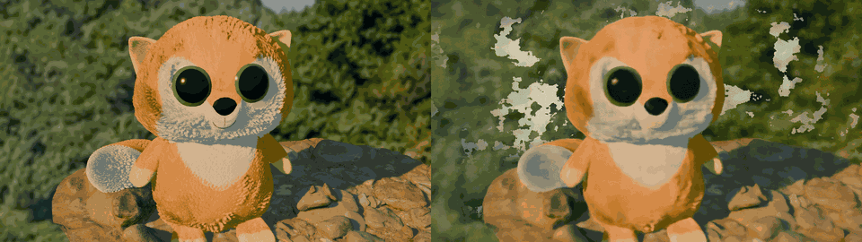

# Neural 3D Reconstruction

Neural rendering and 3D reconstruction experiments built around multi-view images and known camera poses. The repository is aimed at **novel view synthesis** (rendering scenes from new viewpoints) and **neural 3D reconstruction** from captured or synthetic views



Today the codebase implements a **NeRF** (Neural Radiance Fields) trainer and renderer. Planned extensions include **3D Gaussian Splatting** and utility scripts to extract triangle meshes from trained representations—those parts are not in the repo yet, but the layout is intended to grow into a small toolkit rather than a single NeRF script

## What you can do now


| Task                                                            | Entry point          |
| --------------------------------------------------------------- | -------------------- |
| Train a NeRF on your multi-view dataset                         | `train.py`           |
| Render images from a trained checkpoint                         | `inference.py`       |
| Build synthetic camera rings for evaluation / fly-through poses | `gen_valid_rings.py` |


Training optimizes a network to predict RGB along rays; rendering walks the same model over full images for each camera in `transforms.json`.

## Requirements

- Python 3.10+ (tested with PyTorch CUDA builds)
- NVIDIA GPU recommended for training (see note below)
- Dependencies: `requirements.txt` (PyTorch with CUDA 12.2 wheel index, `matplotlib`, `tqdm`)

```bash
python -m venv venv
source venv/Scripts/activate   # Windows Git Bash
pip install -r requirements.txt
```

Set `device: cuda` for GPU training or inference and `device: cpu` for CPU execution.

## Dataset layout

Data follows the common NeRF / Blender JSON format:

```
your_dataset/
├── transforms.json
├── frame_000.png
├── frame_001.png
└── ...
```

`transforms.json` must contain a `"frames"` list. Each frame entry needs at least:

- `file_path` — image path relative to `data_dir`
- `transform_matrix` — 4×4 camera-to-world matrix
- `fl_x`, `fl_y` — focal lengths in pixels
- `w`, `h` — image size
- `camera_angle_x`, `camera_angle_y` — field-of-view angles (stored for compatibility)

Images may include an alpha channel. The trainer composites RGBA onto the background selected by `nn_params.white_bkgd` and the renderer uses the same background. Optional `cx` and `cy` specify the principal point in source-image pixels.

## Configuration

Two templates ship with the repo:


| File                        | Purpose                                                                   |
| --------------------------- | ------------------------------------------------------------------------- |
| `default_train_config.yaml` | Hyperparameters, paths, training and periodic render settings             |
| `default_inf_config.yaml`   | Checkpoint path, architecture params (must match training), render output |


Copy them to local files (for example `config_train.yaml` and `config_inf.yaml`), edit paths and hyperparameters, and pass the paths to the scripts. Local config copies are typically gitignored so experiments stay on your machine.

Important training fields:

- `data_dir`, `experiment_dir` — input dataset and output run folder
- `nn_params` — network depth, scene coordinates, background, coarse sampling (`near`, `far`, `num_samples`) and extra fine samples (`num_importance`)
- `num_rays_per_image`, `sample_strategy`, `sampler_params` — how many rays per image per epoch and how pixels are chosen
- `valid_frac` — random hold-out fraction of frames for validation loss
- `render_from`, `render_every`, `render_num_images` — when to save train/valid renders during training

Inference must reuse the same `nn_params` as training and set `model_path` to a saved `model.pth`

## Usage
### Train

```bash
python train.py --config config_train.yaml
```

Each run creates a new directory under `experiment_dir` (if the path already exists, a suffix `_1`, `_2`, … is added). The run folder contains:

- `config.yaml` — frozen copy of the training config
- `history.json`, `history.png` — summed coarse and fine training MSE and fine MSE on a fixed validation ray sample
- `camera_poses.png` — train vs validation camera layout
- `renders_train/`, `renders_valid/` — originals and epoch snapshots
- `model.pth` — final weights

### Inference / novel views

```bash
python inference.py --config config_inf.yaml
```

Loads `model_path`, reads all frames from `data_dir/transforms.json`, and writes PNGs to `render_dir` or an auto-numbered sibling. Optional `width` and `height` override the base resolution before downsampling. Intrinsics scale to the final resolution.

### Synthetic validation rings

For viewpoints without real photos (only poses), generate a circular camera path:

```bash
python gen_valid_rings.py --output-dir path/to/ring --axis z --radius 8.0 --num-cameras 36
```

This writes `transforms.json` and `camera_poses.png`. Image paths in the JSON are placeholders (`camera_000.png`, …); inference still renders from the trained model even if those files are missing, as long as you only need synthetic views. For training, real images must exist at the listed paths.

Supported ring axes: `x`, `y`, `z` (ring lies in the plane perpendicular to the chosen axis).
Use `--center X Y Z` to set the ring center and look-at target in world coordinates.

## Pixel sampling strategies

During training, rays are resampled every epoch. Set `sample_strategy` in the training config:


| Strategy     | Behavior                                                                                          |
| ------------ | ------------------------------------------------------------------------------------------------- |
| `random`     | Uniform random pixels                                                                             |
| `gaussian`   | More samples near the image center                                                                |
| `foreground` | Mix of transparent (alpha = 0) and opaque pixels; tune `transparent_fraction` in `sampler_params` |


Implementations live in `samplers.py`.

## Rendering issues and fixes

1. **Shifted copies of the fox.** The old positional encoder applied sine and cosine directly to Blender world coordinates. Its frequencies shared a period of two Blender units, so points separated by two units along any world axis produced effectively identical inputs. The network could assign the same density to the fox and to empty space at that offset. A copy in front of the real surface could also obscure it. The encoder now passes the three coordinates alongside the Fourier features, giving the MLP 3 * (1 + __L_coords__ * 2) position inputs and removing the forced repetition. It also subtracts the camera aim point `nn_params.scene_center` and multiplies by `nn_params.scene_scale` before encoding. This centers the coordinates around the subject and sets the spatial scale of the Fourier features. Ray distances still use Blender units. The periodicity explains a possible source of ghosting
2. **Thin details fell between depth samples.** The old renderer queried fixed depths, with a large spacing between `nn_params.num_samples` samples in Blender units. A ray could cross a thin surface without a sample in the dense part. As the viewing angle changed, samples could hit or miss that surface, producing bands or intermittent details. During training, each coarse sample now moves randomly inside its own interval, so repeated queries cover different depths. Evaluation uses fixed depths for reproducible frames
3. **Uniform sampling spent too many queries in empty space.** Model now uses two instances of `RadianceField` with the same architecture and separate learned weights. Each maps position and view direction to density and RGB. Coarse evaluates `nn_params.num_samples` points across the ray and estimates how much each contributes to the pixel. Those weights guide placement of __num_importance__ more points near visible surfaces. Fine evaluates all `nn_params.num_samples + nn_params.num_importance` points with its own weights to produce the final RGB. Each network learns from the same source pixel through its own rendering loss. Evaluation uses fixed quantiles to place the additional samples
4. **The MLP differed from the original architecture.** The positional skip now follows the fifth hidden layer, and a separate linear projection supplies spatial features to the RGB branch. Density depends on position, while color can also depend on viewing direction. ReLU replaces LeakyReLU in the new hidden layers and Softplus in the density output. The old Softplus gave the last sample positive density, which could make the artificially long final interval opaque even in empty space. ReLU allows that sample to have zero density and let the background show through
5. **Transparent pixels needed a consistent background.** The old loader discarded PNG alpha, so RGB stored under transparent pixels could become a training target. The default white background follows the authors’ Blender setup. Training composites the RGBA image onto white before resizing, and the renderer fills the portion of the ray that remains transparent with the same white. The setting is configurable through `nn_params.white_bkgd`
6. **Ray bounds and camera settings affected coverage and framing.** The old `nn_params.far` ended at the camera aim point on central rays. Configuration uses new values to sample on both sides of that point. The new range is based on the camera layout. Training and rendering now scale focal lengths and the principal point to the actual output dimensions through the same function. Synthetic camera rings can use `--center` to orbit and aim at the scene center
7. **Training and validation were hard to compare.** First experiments used center-biased sampling, including on validation, where the sampled pixels also changed between epochs. The current setup draws uniform training pixels and uses a seeded frame split and a fixed, uniform validation sample. Training reports the sum of coarse and fine losses, while validation measures fine RGB MSE on the fixed sample

## Repository layout

| File                        | Role                                                                                                                              |
| --------------------------- | --------------------------------------------------------------------------------------------------------------------------------- |
| `train.py`                  | CLI for training: load config, split frames, build dataloaders, optimization loop, periodic renders, save checkpoint and metrics |
| `inference.py`              | CLI for loading `model.pth` and rendering all poses in `transforms.json`                                                         |
| `model.py`                  | `NeRF` module: positional encoding, MLPs for density and color, volume rendering along rays                                      |
| `dataset.py`                | `NeRFDataset` (ray batches from multi-view images), ray geometry helpers, train/valid split, point sampling along rays           |
| `render.py`                 | Full-image rendering: generate all pixel rays, batched forward passes, save PNGs                                                 |
| `samplers.py`               | Pixel index samplers used when choosing training rays each epoch                                                                 |
| `utils.py`                  | Experiment directory creation (auto-increment if exists), loss history JSON/plots, camera pose visualization                     |
| `gen_valid_rings.py`        | Standalone tool to emit circular camera paths as `transforms.json` for evaluation trajectories                                   |
| `default_train_config.yaml` | Documented template for training                                                                                                 |
| `default_inf_config.yaml`   | Documented template for inference                                                                                                |
| `requirements.txt`          | Python dependencies (PyTorch CUDA wheels + plotting/progress)                                                                    |

## Roadmap

- **NeRF** — current focus: train, validate, render
- **3D Gaussian Splatting** — planned as an additional representation and training path for faster real-time-style rendering
- **Mesh extraction** — planned scripts to recover explicit surface meshes from trained models

Contributions and experiments should stay config-driven (YAML) and follow the same pattern: dataset → train → artifact directory → inference / export.

## Tips

- Match `near` / `far` to your scene scale (distance from cameras to content along rays)
- Increase `num_rays_per_image` and `num_epochs` for quality; use `img_downsample` for faster iteration
- Keep `nn_params` identical between training and inference configs
- Compare `renders_valid/original/` with `renders_valid/epoch_*` during training to spot overfitting or bad bounds

